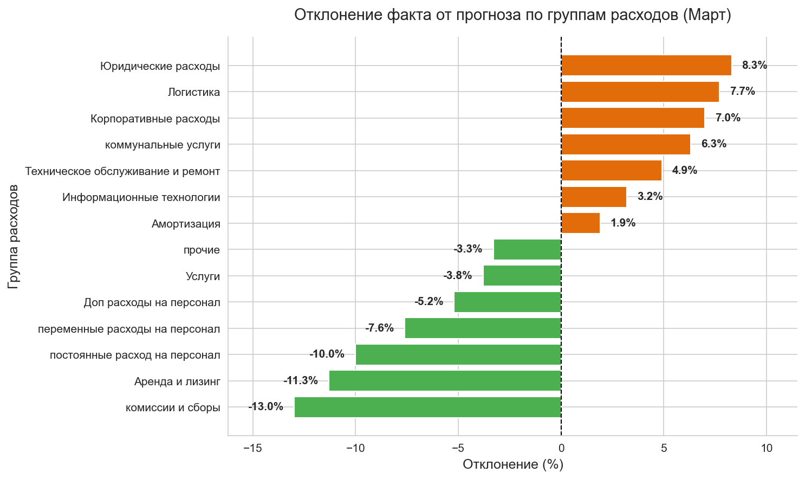

# Автоматизация бюджетирования и план-факт анализа (FP&A)

### О проекте

Более 5 лет я работала в подразделениях FP&A (Financial Planning & Analysis) в различных компаниях (FMCG, IT). В некоторых из них основным инструментом для бюджетирования, прогнозирования и сбора факта оставался Excel. Процесс сбора, очистки, обработки и консолидации данных занимал колоссальное количество времени. Поэтому я решила автоматизировать этот процесс.

Цель проекта — сократить время закрытия периода, обновления данных для прогноза, минимазировать вероятность технических ошибок, автоматизировать создание отчетов для руководства и бюджетодержателей.

Здесь представлена **упрощенная версия** того, что я имею в виду под автоматизацией. В реальной работе, безусловно, всё сложнее: иногда нужно консолидировать данные по нескольким юридическим лицам, вести аналитику в разрезе конкретных проектов или клиентов (юнит-экономика), делать более сложный матчинг статей факта и прогноза/бюджета из-за несовпадения кодов или названий статей в учетных системах и т.д.
Поэтому я считаю, что автоматизация не заменит финансового аналитика или бизнес-партнера, но поможет снизить временные затраты на рутинные процессы и сосредоточиться на поиске точек оптимизации и повышения эффективности бизнеса.

## Структура проекта

[Исходные данные](./Исходные%20данные/) (бюджет и выгрузки из ERP систем) собраны в одной папке, все результаты автоматически складываются в другую — [Результат](./Результат/).

Ежемесячно в работе аналитика существуют два процесса:
1. анализ факта ([Аналитика/факт](./Результат/Аналитика/факт/)).
2. Обновление и анализ прогноза ([Прогнозы](./Результат/Прогнозы/) и [Аналитика/прогноз](./Результат/Аналитика/прогноз/)).

Для качественного выполнения этих задач аналитик предоставляет каждому бюджетодержателю актуальные данные по расходам в его компетенции ([Бюджетодержатели/для отправки](./Результат/Бюджетодержатели/для%20отправки/)) и собирает пояснения отклонений и корректировки прогнозов ([Бюджетодержатели/полученные](./Результат/Бюджетодержатели/полученные/)).

## Реализация проекта
Все этапы реализованы в [main.ipynb](./main.ipynb) и запускаются последовательно. Для корректной работы необходимо сделать лишь несколько "ручных" действий:
- выгрузить из ERP файл с фактом в папку с исходными материалами (этот процесс тоже можно автоматизировать)
- поменять значение в переменной ACTUAL_MONTH на текущий месяц
- запустить скрипт 

### 1. Работа с фактом
**1.1. Обработка выгрузки (ETL) и обновление сводного факта** 
Скрипт принимает «сырую» выгрузку из учетной системы (SAP/1C), где данные представлены множеством транзакций. Происходит агрегация сумм по кодам статей, проверка на дубликаты и матчинг с бюджетом по строгим правилам. Новые данные за текущий месяц добавляются в накопительный файл `факт_сводный.xlsx`. Скрипт защищен от повторного запуска за один и тот же месяц (перезаписывает данные, а не дублирует их).

**1.2. План-факт анализ**
Формируется управленческий отчет для руководства:
* Расчет отклонений (в рублях и процентах).
* Автоматическая подсветка критических отклонений (более 10%).
* Создание сводных таблиц по группам расходов.
* Построение графиков отклонений и встраивание их прямо в Excel-файл.
  
> **Пример готового файла:** [Отчет_Факт_Март.xlsx](./Результат/Аналитика/факт/март/Отчет_Факт_Март.xlsx)
>
> **Пример графика отклонений за месяц (встроен в файл выше):**
> 

**1.3. Создание отдельных файлов для бюджетодержателей**
Скрипт автоматически «нарезает» общий отчет на отдельные файлы для каждого департамента. Файлы защищены от случайных правок (можно менять только комментарии и обновленный прогноз), а на Листе 4 встроены Excel-формулы, которые мгновенно пересчитывают годовой эффект (Dif-Dif) от правок пользователя.

> **Пример файла для одного подразделения:** [Департамент технического обслуживания_март.xlsx](./Результат/Бюджетодержатели/для%20отправки/март/Департамент%20технического%20обслуживания_март.xlsx)
>
> **Внутренняя инструкция для пользователей (встроена в файл):**
> 

**1.4. Сбор данных от бюджетодержателей**
В реальной работе аналитик получает заполненный файл два раза в месяц — один раз в начале месяца с комментариями факта, второй раз — в середине с корректировками прогноза.

### 2. Работа с прогнозом
**2.1. Обновление прогнозного файла** 

**2.2. Анализ изменений прогноза** по сравнению с предыдущим прогнозом или бюджетом.

## **Результат:** 
Теперь весь процесс от загрузки «сырой» выгрузки до получения готовых управленческих отчетов и защищенных файлов для бюджетодержателей занимает всего пару минут)

## Что еще можно автоматизировать
1. **Настройка базы данных:** Сохранение основных данных (факта, бюджета, последних версий прогноза, сценарных версий) в базе данных (например, ClickHouse). Это повысит надежность хранения данных, ускорит обработку больших объемов и обеспечит единую точку правды (Single Source of Truth). При этом аналитические формы, графики и файлы для бюджетодержателей также будут формироваться в Excel для удобства пользователей.
2. **Создание дашбордов:** Разработка интерактивных дашбордов с автоматическим обновлением данных из базы данных. *Пример разработки системы дашбордов компании (макет и сам дашборд) представлен другим проектом в отдельном репозитории — **[dashboards](https://github.com/Innspired/dashboards)** 
3. **Оркестрация и алерты:** Отправка автоматических рассылок и алертов (например, при превышении отклонений) с помощью Apache Airflow. Пример представлен другим проектом в отдельном репозитории — **[airflow_data_pipelines](https://github.com/Innspired/airflow_data_pipelines)**.

## Стек технологий
*   **Язык:** Python
*   **Обработка данных:** Pandas, NumPy
*   **Работа с Excel (чтение/запись/стили/защита):** Openpyxl, XlsxWriter
*   **Визуализация:** Matplotlib
*   **Среда разработки:** Jupyter Notebook

